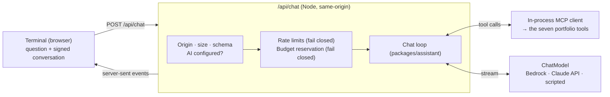

# AI assistant

Visitors can ask the terminal questions in plain English ("Which project best
demonstrates Docker?") and follow up. The assistant answers only from the
verified portfolio, through the same MCP tools external clients use, streams
its answer, and shows where every fact came from. Commands never depend on it.

## Architecture

| Piece | Where | Role |
| :-- | :-- | :-- |
| `ChatModel` interface | `packages/assistant/src/model.ts` | The only thing the loop knows about a model |
| `ClaudeModel` | `.../claude.ts` | One adapter for Bedrock (`AnthropicBedrockMantle`) and the Claude API (`Anthropic`) |
| `ScriptedModel` | `.../scripted.ts` | Deterministic, free, offline: every test and local development |
| `runChat` | `.../chat.ts` | Tool rounds over MCP, cost ceiling, sources, grounding |
| System prompt | `.../prompt.ts` | Frozen and versioned (`PROMPT_VERSION`); part of the cached prefix |
| Route | `apps/web/src/server/ai/handler.ts` | Checks, limits, budget, transcript signing, streaming |
| Provider choice | `apps/web/src/server/ai/provider.ts` | The only provider-specific code |

Switching provider is configuration: `AI_PROVIDER=bedrock|anthropic|scripted`.

## How an answer is produced

1. The terminal sends the question and the signed conversation so far (plain text turns only).
2. The route checks the request, then the visitor's rate limits and the budget. All of these fail closed.
3. The loop lists the MCP tools and calls the model. When the model asks for a tool, the loop calls it through an in-process MCP client and returns the structured result. This runs at most 4 rounds, two or so in practice.
4. Text streams to the terminal **one checked sentence at a time** (see Grounding), with a status line for each lookup.
5. When finished, the route sends:
   - the sources, collected from the citations in the tool results actually used, not from the model's text;
   - the projects named in the answer, as clickable commands;
   - how many statements were withheld;
   - the new conversation, signed.

## Grounding

- **One source of facts.** The tools expose only verified content, and the prompt requires a tool call before any fact.
- **Rules in the prompt.** No outside knowledge; no inferred metrics, titles or responsibilities; keep individual, collaborative and team scope; say when something isn't documented; refuse off-topic requests; treat tool content as data. Earlier turns are context, not evidence.
- **Deterministic sources.** The sources list under each answer comes from the tool results, never from the model's text.
- **Sentence gate (before display).** Streamed text is held until a sentence ends (`.`, `!` or `?` before a space, or a line break), then checked and released. A run of more than 280 characters without a sentence end is released at its last space. Sentences are checked as follows:
  - **What's checked:** every figure in the sentence (a number of two or more digits, a decimal or a percentage) must appear **as a whole number** in **this turn's tool results**. `50` doesn't match `50,000`; `5.4` matches `5.4M`; `2623` matches `2,623`; a bare `99.9` matches `99.9%`, but `85%` doesn't match `85`.
  - **What fails:** a sentence that fails is **withheld entirely**. It's never displayed, never signed into the conversation and never counted as part of the answer. A notice says how many statements were withheld.
  - **What isn't evidence:** the visitor's question and earlier turns, even signed ones. "Did Alex manage 50 engineers?" can't make "50" acceptable.
  - **Latency:** at most one sentence. Text appears sentence by sentence rather than token by token, which keeps streaming responsive. A tool round is usually the longer wait.

**What this cannot do.** The check covers numbers, not facts, so it cannot guarantee accuracy. It does **not** catch:
- a paraphrase that overstates ownership or scope with no numbers ("single-handedly scaled the platform");
- a real figure attached to the wrong fact ("the chat handled 2,623 conversations": 2,623 is the test count);
- numbers written as words, or single digits.

Those are addressed by the prompt's rules, the always-visible sources and the evaluation, not by this check. Each of these limits has a test that pins it down (`packages/assistant/test/gate.test.ts`, the `LIMIT:` cases).

**It also can't read negation, and that's deliberate.** "The portfolio doesn't record an 82% accuracy figure" is withheld when 82% isn't in the tool results, even though the sentence denies it. This happened in the Haiku evaluation (October 2026): the visitor asked "Is Total Guess's hybrid search 82% accurate?"; 82% appears nowhere in the portfolio (the measured result is an nDCG@10 of 0.819); the sentence made no false claim, but the gate withheld it. **The gate was left unchanged.** Exempting negated sentences would let a sentence that only looks negated ("not only 82% accurate but…") carry an unverified figure to the visitor, and that's exactly what fail-closed exists to prevent. The fix belongs in the prompt instead: refer to an unrecorded figure from the visitor without repeating the number.

**Absence claims.** A partial lookup once led the model to say the portfolio didn't record things it does record: Clash of Langs' reason for not using Vercel, and ZIM@SBB's responsibilities. There are now two structural safeguards:
- **A leak check on every sentence.** A sentence that repeats eight or more consecutive words of the system prompt, contains a credential format or names a secret setting is withheld, and the visitor is told only that internal configuration was withheld. Questions are cleaned of escape, control and invisible characters before they reach the model. See [AI_GUARDRAILS.md](AI_GUARDRAILS.md).
- **Follow-ups come from evidence, not another model call.** The `done` event names the STAR stories the answer told (examples this turn retrieved whose action and result the answer retells, or whose title it names). The terminal offers the full story, another example, and Alex's role on the one project the answer was about; nothing else.
- **Retrieval says what it left out.** `get_project` reports the sections it retrieved, the sections with content it didn't, and whether the record is complete. The chat loop passes the visitor's question as `relatedTo`, so a partial record also carries the omitted passages that match it, at most four, never whole records. For "Why doesn't Clash of Langs run on Vercel?", that brings in "Vercel hosts only the UI and a thin API".
- **Examples count as part of a project.** A published STAR example can hold a fact its project's record doesn't (the SNS migration and the AWS cost review are told only in ZIM Connections' examples). So `get_project` lists the project's examples, adds the example passages that match the question (`relatedFromExamples`, each with its basis), and reports `complete: false` while the project has examples, even when every section was fetched. `search_projects` also names the examples that match. With no published examples (as now), the output is exactly as before.
- **A fail-closed check on whole-section claims.** A sentence saying the portfolio doesn't record a project's responsibilities, decisions, challenges (or another section) is withheld when that section has content but wasn't retrieved this turn, and the visitor sees a notice. The project is the first one the sentence names, else the last one named earlier in the answer. To check this, the loop loads each project's full record once per answer, for verification only: those records are never evidence for the figure check and never reach the model. Claims about a specific fact aren't checked this way. Replayed against 138 recorded answers, a word-matching version withheld 10 to 13 correct "not documented" sentences per run, while the section-level rule withheld only the one false claim. Specific facts are covered by the retrieval safeguard and the prompt instead. A project's examples count as one more section: "the portfolio has no examples of…" about a project is withheld until `get_examples` has either returned everything that matched or told each of that project's examples.

**Presentation guards (after the checks).** Released sentences pass through deterministic rewrites, applied after the checks so they can't affect them:
- internal project ids become display names (`zim-sbb` → ZIM@SBB), matching whole ids only, never inside URLs or repository names;
- Markdown bold markers and heading hashes are removed, because the terminal shows plain text and would print them literally;
- a pasted "Sources:" line is removed. The terminal doesn't show a source list under answers (removed 2026-10-20 at Alex's request); sources are still recorded with each answer for evaluation, and project pages keep their sources.

## Conversation history

The server is stateless and stores nothing.
- **What's sent.** The browser keeps the conversation and sends the last six exchanges (≤ 12,000 characters) with each question. Turns are plain text. Tool calls, results and thinking stay inside the request that produced them. Current models reject edited histories that still contain thinking blocks, and a history with none avoids that.
- **Signed turns.** Each transcript the server returns is signed with HMAC-SHA256 (`CHAT_TRANSCRIPT_SECRET`). The signature covers a version tag, the issue time and **every turn's role and text, in order**, encoded unambiguously. Editing, reordering, dropping or adding any turn, or changing the time, invalidates it. Verification is constant-time.
- **Expiry.** Transcripts are valid for 24 hours (with a minute's clock tolerance). An expired or future-dated transcript is rejected, so an old one can't be replayed indefinitely. Replaying a still-valid transcript is harmless: it only contains text this server produced.
- **Rejection.** A rejected transcript is dropped with a notice ("couldn't be verified" or "has expired"), and the answer starts afresh. The rejection reason is logged; the content isn't.
- **Context, never evidence.** Even a valid transcript is used only to understand follow-up questions. Figures are checked against this turn's tool results alone, and the prompt tells the model to look facts up again rather than repeat earlier answers.
- **Cache-friendly.** The system prompt and tools carry a cache breakpoint, and earlier turns are append-only, so repeated prefixes are read from the prompt cache.

## Cost controls

| Control | Default | Setting |
| :-- | :-- | :-- |
| Daily / monthly spend caps | $10 / $50 | `AI_DAILY_BUDGET_USD`, `AI_MONTHLY_BUDGET_USD` |
| Reserved per answer (its hard ceiling) | Derived per model, below | from the three limits that follow |
| Output tokens per model call (includes thinking) | 2,048 at effort `medium` | `AI_MAX_OUTPUT_TOKENS`, `AI_EFFORT` |
| Input tokens per model call | 24,000 (max 90,000, which keeps Haiku 5.5 in its ≤100K-token price band) | `AI_MAX_INPUT_TOKENS_PER_CALL` |
| Model calls per answer | 4 | `AI_MAX_TOOL_ROUNDS` |
| Timeout per answer | 30 s | `AI_TIMEOUT_MS` |
| Per-visitor limits | 5 / minute, 30 / day | `AI_QUESTIONS_PER_MINUTE`, `AI_QUESTIONS_PER_DAY` |
| Kill switch | on | `AI_ENABLED=false` |

**The reservation is the model's true maximum.** `maxRounds × (maxInputTokensPerCall × max(input, cache-write price) + maxOutputTokens × output price)`, rounded up:

| Model | Per answer (defaults) | Answers that could be in flight within $10/day |
| :-- | --: | --: |
| Claude Opus 5.5 | $0.64384 | 15 |
| Claude Sonnet 5.5 | $0.32192 | 31 |
| Claude Haiku 5.5 | $0.016096 | 621 |

Thinking is on by default on these models: it counts toward the output limit and is billed as output, even though the visitor never sees it. The limit of 2,048 leaves room for medium-effort thinking plus a full answer. An answer that still reaches it ends with a notice, and the evaluation reports it as truncated, separately from wrong answers.

A configuration whose ceiling exceeds the daily budget is refused outright.

**How the budget holds under concurrency:**
- Before any model call, the answer's ceiling is reserved with atomic `INCRBY` on both the day and month counters in Upstash (`portfolio:budget:ai:day:<date>` and `portfolio:budget:ai:month:<month>`). Each increment runs in one Lua script with the counter's expiry: 2 days for a day counter, 35 days for a month counter. A counter can therefore never be left without an expiry in the shared database. A reservation that would cross a cap is rolled back and refused. Every in-flight answer's ceiling is already counted, so concurrent answers can't overspend between them. The $10 and $50 caps are unchanged.
- Before *each* model call, the loop refuses to start if its input could exceed the per-call cap, or if what's been spent plus that call's worst case could exceed the reservation. The first call's input is a generous estimate (≈3 characters per token). Later calls are calibrated with the token counts the model actually reported for the previous call, plus an estimate for the new tool results.
- Afterwards the reservation is settled to the actual cost, from the model's reported token usage and the verified price table.

**Small overruns are possible.** Exact token counts are only known after a call, so the caps rely on estimates. The first call's estimate is deliberately generous, and later calls are calibrated with real counts. If an estimate were ever lower than the real count, one answer could cost slightly more than its reservation. The overrun is recorded when the answer settles, which pushes the counters past the cap and refuses further answers. The caps can therefore be exceeded by a small amount, bounded by the estimation error of answers already in progress, but not continuously. A provider-side alert (AWS Budgets) is the estimate-free backstop.

**When something fails:**
- An unreachable or slow (> 750 ms) budget store refuses the answer.
- A failed settlement leaves the reservation counted: an over-count, never an under-count.
- A provider model without a verified price can't be configured at all, because its spend couldn't be capped.

Prices (USD per million tokens, global routing, 5-minute cache writes; verified 2026-10-19 from Anthropic's pricing page for the Claude API and the AWS Price List API for Bedrock, which agree):

| Model | Input | Output | Cache read | Cache write |
| :-- | --: | --: | --: | --: |
| Claude Opus 5.5 | 4.00 | 20.00 | 0.20 | 5.00 |
| Claude Sonnet 5.5 | 2.00 | 10.00 | 0.10 | 2.50 |
| Claude Haiku 5.5 (default) | 0.10 | 0.50 | 0.01 | 0.125 |

Haiku 5.5 is the default model (`AI_MODEL`), chosen for cost, subject to the evaluation. Its prices apply to prompts of up to 100,000 tokens; longer prompts cost five times as much. The per-call input cap tops out at 90,000 tokens, so that higher tier can't apply, and the configuration refuses any per-call cap that could reach a model's priced limit. Changing the model is a configuration change you review; nothing switches models automatically.

## Failure behaviour

| Situation | Visitor sees |
| :-- | :-- |
| AI off, misconfigured, limiter or budget store down | "The AI assistant isn't available right now…", plus the local search results for the question |
| Budget reached | "…reached its spending limit for now…", plus local results |
| Too many questions | "That's a lot of questions in a short time…" (429) |
| Model error | "…ran into a problem…". Details stay in server logs (error type only) |
| Refusal, truncation, round or cost limit | The partial answer plus a short notice |
| Visitor cancels (Esc / Ctrl+C) | "Stopped." The model call is aborted and only what was spent is billed |

Logs record model, provider, prompt version, stop reason, rounds, tools, token usage, cost, duration, withheld-statement count and any transcript rejection reason. Never the question text, answers or client addresses.

## Configuration

See `apps/web/.env.example`. In development with no settings, the assistant uses the scripted model: answers come from a deterministic search over the portfolio, and each one carries a "Demo mode" notice so it is never mistaken for AI. Production requires `AI_PROVIDER`, `CHAT_TRANSCRIPT_SECRET` (≥ 32 characters) and Upstash. The scripted model is refused on Vercel production.

Bedrock on Vercel authenticates with OIDC (`AI_BEDROCK_ROLE_ARN`). See [`infra/bedrock/README.md`](../infra/bedrock/README.md) for the role and activation steps.

## Tests

No test makes a paid call or needs AWS credentials.

| Suite | Covers |
| :-- | :-- |
| `packages/assistant/test/chat.test.ts` | The loop against the real MCP tools: streaming, attribution, history as text, tool-error recovery, parallel calls, round, cost and input-token limits, refusal and truncation, cancellation, model failure, the demo script |
| `packages/assistant/test/gate.test.ts` | The sentence gate: sentence-by-sentence release, withholding, decimals and names with dots, long runs, list items; end to end: invented figures, figures with no lookup, figures from the question or earlier turns, equivalent formats, and the `LIMIT:` cases it can't catch |
| `packages/assistant/test/units.test.ts` | The Claude adapter against a fake client (request shape, cache breakpoint, effort, no `thinking` override, verbatim replay of thinking blocks within a turn), prices and per-model ceilings, figure matching, citations, transcript signing (edited, reordered, dropped, appended, whitespace, re-timed, other key, malformed, expired, future-dated) and trimming |
| `apps/web/test/chat-handler.test.ts` | The route: sentence-gated stream, withheld statements kept out of the signed conversation, history never as evidence, transcript tampering, replay and expiry, budget reservation and settlement, every refusal (403, 400, 405, 413, 415, 429, 503), cancellation, log hygiene |
| `apps/web/test/ai-server.test.ts` | Budget atomicity under 50 concurrent reservations, monthly roll-back, fail-closed store, per-model ceilings, ceilings above the daily cap refused, configuration rules |
| `apps/web/test/chat-client.test.ts` | Server-sent event parsing, answer state, question routing |
| `apps/web/e2e/ai.spec.ts` | In the browser, through the real route and MCP tools with the scripted model: streaming with sources, follow-ups, budget exhaustion, cancellation, `clear`, accessibility |

The paid evaluation (38 conversations, 46 turns, across Haiku, Sonnet and Opus 5.5, at most $3.65 in total) is described in [EVALUATION.md](EVALUATION.md). It runs only once model access is confirmed and the run is approved, and its spend counts toward the same caps.
