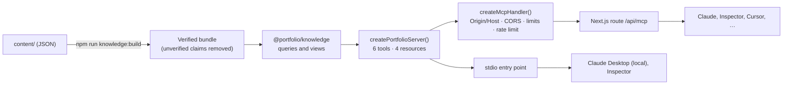

# MCP server

The portfolio is also a public, read-only [Model Context Protocol](https://modelcontextprotocol.io) server. Any compatible AI client can explore the same verified knowledge the terminal shows: the six featured projects, the profile, experience and skills.

- **Endpoint:** `https://<your-domain>/api/mcp` (Streamable HTTP, stateless, JSON responses)
- **Local:** stdio, via `npm run mcp:stdio`
- **Protocol:** MCP `2025-11-25`, through the official TypeScript SDK (`@modelcontextprotocol/sdk` 1.32.1)
- **Authentication:** none. Everything exposed is public, and nothing can be changed.

## Architecture



- `packages/mcp-server` holds the server. It reads the same generated bundle as the terminal, through the same queries in `@portfolio/knowledge` (project lookup, section selection, experience, citations). There is no second copy of the data.
- `createMcpHandler` is a plain `Request → Response` function, so the Next.js route is a few lines, and the whole HTTP layer is tested without a server.
- Each request gets a fresh server and transport, and nothing is kept between requests, which suits serverless hosting.

## Tools

All six are read-only and annotated `readOnlyHint: true`, `destructiveHint: false`, `idempotentHint: true`, `openWorldHint: false`. Inputs are validated with Zod. Each tool declares an `outputSchema` and returns `structuredContent`, plus the same JSON as text for older clients.

| Tool | Input | Returns |
|---|---|---|
| `list_projects` | — | The six projects: id, name, focus, tagline, tags, context and resource URI, plus a `resource_link` to each document |
| `get_project` | `project` (id, alias, name or number, ≤ 100 chars); optional `sections[]` | The project's identifying fields plus the requested sections (all by default), with `citations` for exactly the sources those sections cite |
| `search_projects` | `query` (≤ 200 chars); `limit` 1–10 (default 5) | Ranked projects, each with the matched passages, their source ids and `citations` |
| `get_profile` | — | Summary, location, contact links, languages, working approach and AI use, with `citations` |
| `get_experience` | — | Three separate sections: `employment` (each role with the responsibilities from its linked projects, scope intact, and per-project `citations`), `education` and `certifications`, with profile `citations` |
| `get_skills` | optional `category` | Skills, each linked to the projects that demonstrate it, with `citations` |

`get_project` sections: `overview`, `technologies`, `responsibilities`, `architecture`, `challenges`, `decisions`, `lessons`, `limitations`, `links`, `undocumented`.

**Attribution.** Every fact carries `sources`: ids that resolve, in the same result, to `citations` entries with a label, kind and URL where one exists. Responsibilities carry a `scope`:
- `individual`: Alex's own work.
- `collaborative`: Alex working with others.
- `team`: a team result Alex contributed to.

`undocumented` lists topics with no verified information, so clients can say so instead of guessing.

**Errors.** An unknown project is a tool error (`isError: true`) the model can recover from. It suggests the closest match and lists the valid ids. Invalid input is rejected by schema validation. Unexpected failures return a generic message and are logged on the server; internals never reach the client.

## Resources

Markdown documents that clients can attach to a conversation directly. Every claim carries a footnote (`[^cv]`), and each document ends with a **Sources** section resolving them.

| URI | Content |
|---|---|
| `portfolio://profile` | Summary, employment, education, certifications, working approach, languages, contact |
| `portfolio://skills` | Skills by category, linked to project documents |
| `portfolio://projects` | Index of the six projects |
| `portfolio://projects/{id}` | Full documentation of one project: overview, responsibilities with scope, technologies, architecture with Mermaid diagrams, challenges, decisions with rationale, lessons, limitations, links, "not documented yet", sources |

The template lists all six projects and supports id completion. Only canonical ids resolve, so every document has exactly one URI; anything else returns resource-not-found (`-32002`). These URIs are stable public API.

## Connecting a client

Replace `<your-domain>` with the deployed domain. For a local dev server, use `http://localhost:3000/api/mcp`.

### Claude Desktop and claude.ai

Settings → **Connectors** → **Add custom connector**, name it, and enter `https://<your-domain>/api/mcp`. No OAuth is needed.

To run it locally over stdio instead, add this to `claude_desktop_config.json` (use absolute paths to your clone):

```json
{
  "mcpServers": {
    "alex-jennings-portfolio": {
      "command": "/path/to/portfolio-mcp/node_modules/.bin/tsx",
      "args": ["/path/to/portfolio-mcp/packages/mcp-server/src/stdio.ts"]
    }
  }
}
```

Run `npm install && npm run knowledge:build` in the clone first.

### Claude Code

```bash
claude mcp add --transport http alex-portfolio https://<your-domain>/api/mcp
# or locally over stdio:
claude mcp add alex-portfolio -- /path/to/portfolio-mcp/node_modules/.bin/tsx /path/to/portfolio-mcp/packages/mcp-server/src/stdio.ts
```

### MCP Inspector

```bash
npx @modelcontextprotocol/inspector                       # UI: choose "Streamable HTTP" and enter the URL
npx @modelcontextprotocol/inspector --cli https://<your-domain>/api/mcp --transport http --method tools/list
```

### Other clients

Any client that supports Streamable HTTP (Cursor, VS Code, the official SDKs) can use the URL directly. Clients limited to stdio can use the local entry point, or a bridge such as `mcp-remote`. The deprecated HTTP+SSE transport (protocol 2024-11-05) is not supported.

## Security

| Concern | Measure |
|---|---|
| Changing data | Impossible: tools only read a frozen in-memory bundle. No filesystem, network, database or shell access in any handler |
| Private data | Only the public bundle is loaded, and unverified claims are removed at build time. The phone number and private sources were never in the content |
| Origin (DNS rebinding) | `Origin` is validated on every request, as the MCP spec requires. If present and invalid, the answer is **403**. By default any `https` origin is accepted, plus `http` on loopback (local tools); `null`, malformed and other insecure origins are refused. `MCP_ALLOWED_ORIGINS` can narrow this to a list. Requests without `Origin` (desktop and CLI clients) pass |
| Host | Checked against the deployment's own hosts (Vercel's are added automatically) → **403** otherwise |
| CORS | The validated origin is echoed, with `Vary: Origin`. Credentials are never allowed. Preflights get 204 |
| Methods | `POST` only. Every other method → 405 with `Allow: POST, OPTIONS`; see [Transport compliance](#transport-compliance) |
| Request size | Bodies over 64 KB → 413, enforced while reading, whatever `Content-Length` claims. Content type must be `application/json` (415). One JSON-RPC message per request; batches → 400 |
| Input | Zod schemas with length and range limits on every argument |
| Abuse | Per-client rate limit, 60/min by default → 429 with `Retry-After` and `RateLimit-*` headers. Shared across instances via Upstash Redis. See [Rate limiting](#rate-limiting) |
| Privacy | The rate-limit key is a truncated SHA-256 of the client IP; raw IPs are never stored or logged. Logs record the JSON-RPC method, the tool or resource name, status and duration, never arguments |
| Error detail | Generic messages only. The SDK would otherwise copy a thrown error's message into the result, so every handler catches its own errors |
| Prompt injection | Server instructions tell clients to treat returned content as data, not instructions |
| Timeouts | The route's hosting time is capped at 10 s |

## Rate limiting

| Situation | Behaviour |
|---|---|
| Upstash credentials missing in production | **Fail closed**: every request → 503, logged once. There is no silent fallback |
| `RATE_LIMIT_BACKEND=memory` on Vercel | Refused, so the same as missing credentials (503). Elsewhere it must be set explicitly |
| Upstash configured but erroring, or slower than 750 ms | The limiter's **failure mode** applies. MCP defaults to `open` (requests allowed) because it is read-only and free to serve. Set `MCP_RATE_LIMIT_FAILURE_MODE=closed` to refuse (503) instead |
| Over the limit | 429 with `Retry-After` and `RateLimit-Limit`, `-Remaining` and `-Reset` |

- The store gets one quick retry (Upstash's default is five) and a 750 ms timeout, so a failing store is noticed fast.
- Store failures are logged at most **once a minute per limiter**, with a count of the failures suppressed since. Log lines carry the limiter name, cause (`error` or `timeout`), error type and action. Never the error message (an HTTP client's message can include the Redis URL), credentials or client keys.
- An unrecognised failure mode is treated as `closed`.
- **Anything that costs money must fail closed.** The AI chat (a later stage) uses `failureMode: 'closed'` with no override.

## Transport compliance

Checked against the [MCP 2025-11-25 transport specification](https://modelcontextprotocol.io/specification/2025-11-25/basic/transports). Each row is covered by a test in `packages/mcp-server/test/http.test.ts`.

| Requirement | This server |
|---|---|
| Single endpoint supporting POST and GET | `/api/mcp`. GET answers 405, as the spec allows for servers that offer no SSE stream |
| Every client message is a POST of **one** JSON-RPC message | Arrays (batches) → 400 `-32600` |
| Client `Accept` lists both `application/json` and `text/event-stream` | Enforced: anything else, including `*/*` or no header → 406 |
| A request gets `application/json` or `text/event-stream` | Always one `application/json` object. No SSE, even when the client lists SSE first: every tool answers at once, so streaming would add nothing |
| Notifications and client responses → 202 Accepted, no body | Yes |
| Rejected input → HTTP error; body MAY be a JSON-RPC error with no `id` | Transport errors are JSON-RPC errors **without** `id` |
| GET: SSE stream or 405 | 405 |
| DELETE (session termination): MAY be 405 | 405: no sessions exist |
| Session ids are optional | None assigned (stateless) |
| `MCP-Protocol-Version`: assume `2025-03-26` if absent; 400 if invalid | Yes (from the SDK) |
| Validate `Origin`; 403 if present and invalid | Yes; see [Security](#security) |
| Local servers SHOULD bind to localhost | The Playwright server binds `127.0.0.1`. `next dev` listens on all interfaces, but in development the Host check accepts only loopback names |
| Servers SHOULD authenticate | Deliberately not: the data is public and read-only, and authentication would block anonymous clients |

## Environment variables

See [`apps/web/.env.example`](../apps/web/.env.example).

| Variable | Default | Purpose |
|---|---|---|
| `UPSTASH_REDIS_REST_URL`, `UPSTASH_REDIS_REST_TOKEN` | — | **Required in production.** Shared rate-limit store |
| `RATE_LIMIT_BACKEND` | `upstash` in production, `memory` otherwise | `memory` must be explicit outside development and is refused on Vercel |
| `MCP_RATE_LIMIT_PER_MINUTE` | `60` | Requests per minute per client (1–1000) |
| `MCP_RATE_LIMIT_FAILURE_MODE` | `open` | `open` or `closed`: what happens when a *configured* Upstash fails. Missing configuration always fails closed |
| `MCP_ALLOWED_ORIGINS` | `*` | `*`, or a comma-separated list of allowed browser origins |
| `MCP_ALLOWED_HOSTS` | Vercel's hosts | Extra host names, e.g. both apex and `www` custom domains |

## Deployment (Vercel)

1. Create an Upstash Redis database (the free tier is enough). Add `UPSTASH_REDIS_REST_URL` and `UPSTASH_REDIS_REST_TOKEN` to the Vercel project for Production (and Preview, if previews should serve MCP).
2. If the site has more than one custom domain, list the extra ones in `MCP_ALLOWED_HOSTS`.
3. Deploy. `/api/mcp` runs as a Node.js function; the terminal stays fully static.
4. Check it: `npx @modelcontextprotocol/inspector --cli https://<your-domain>/api/mcp --transport http --method tools/list`.

## Tests

| Suite | Covers |
|---|---|
| `packages/mcp-server/test/tools.test.ts` | Discovery (names, descriptions, annotations, schemas); every tool through the official client, which validates results against each `outputSchema`; section selection; scope attribution; citations resolving every source id; invalid input; unknown projects; generic errors; read-only guarantee |
| `.../resources.test.ts` | Listing, template, completion; each project document complete with every footnote defined; not-found for unknown and non-canonical URIs |
| `.../http.test.ts` | The official Streamable HTTP client through the handler; every row of the compliance table; 202, 400, 403, 405, 406, 413, 415, 429 and 503; CORS and preflight; 500 without leaks; logs without arguments |
| `.../origin.test.ts` | Origin and Host rules, CORS headers, environment parsing |
| `.../stdio.test.ts` | The stdio entry point as a child process, through the official client |
| `apps/web/test/rate-limit.test.ts` | Backend selection (no silent fallback, Vercel refuses memory); open and closed failure modes on errors, hangs and Upstash timeouts; the timeout; throttled logging with no secrets; window counting; bounded memory; IP hashing |
| `apps/web/e2e/mcp.spec.ts` | The official client against the real Next.js production server, plus Origin, CORS, 405 and preflight over real HTTP |

## Adding a knowledge category later

Add its schema and content folder in `@portfolio/knowledge`, then one tool module (registered in `TOOL_MODULES` in `src/server.ts`) and, if it suits, one resource in `src/resources.ts`. The HTTP handler, transports and security layers don't change.
